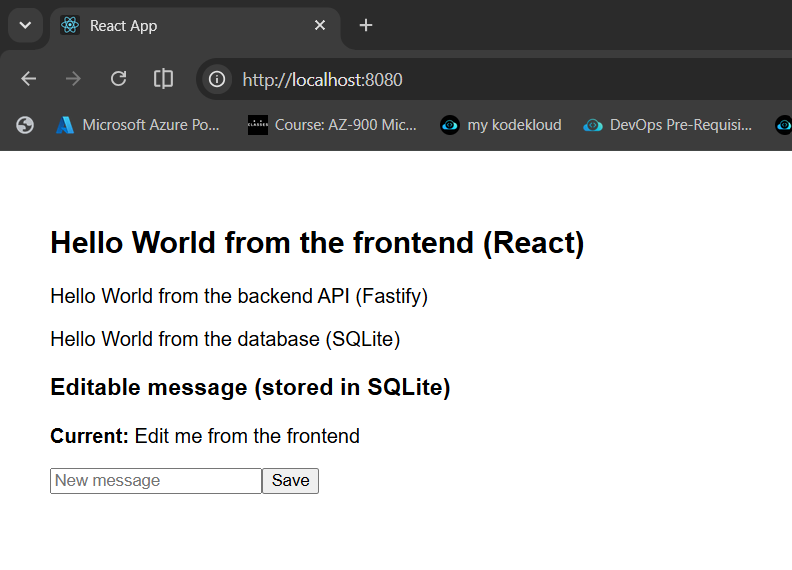
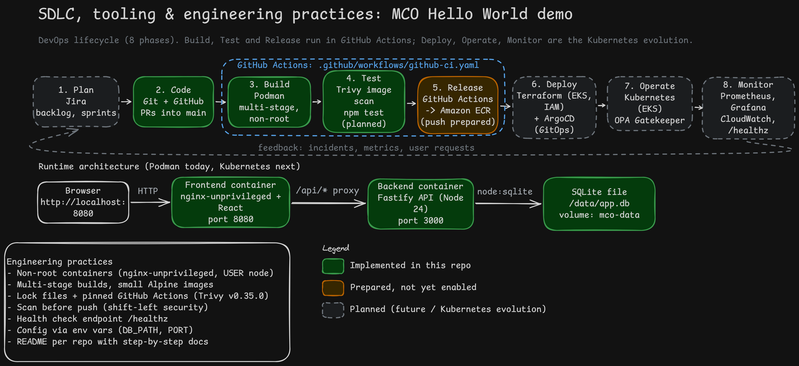

# Hello World: Frontend (React + nginx)

The frontend part of a small three-tier "Hello World" demo application. It is a
React app built into static files and served by nginx, and it shows a
"Hello World" message from the frontend.

## Repository structure

```
MCO-Assignment-FrontEnd/
├── README.md
└── hello-world/          
    ├── public/
    ├── src/
    │   └── App.js        
    ├── package.json
    ├── build/            
    ├── Dockerfile
    ├── default.conf
    └── .dockerignore
```

## Where each capability can be found

| Capability | Location | What it does |
|---|---|---|
| Frontend UI (React) | `hello-world/src/App.js` | Shows the frontend message and calls `/api/hello`, `/api/db/hello` and `/api/message` |
| Production build | `hello-world/build/` (generated by `npm run build`) | Static HTML/JS/CSS served by nginx |
| Web server and API proxy (nginx) | `hello-world/default.conf` | Serves the React build on port 8080 and forwards `/api/` to the backend on port 3000 |
| Container image (Podman) | `hello-world/Dockerfile` | Two-stage build: Node builds the React app, `nginx-unprivileged` serves it as a non-root user |
| Build exclusions | `hello-world/.dockerignore` | Keeps `node_modules`, `build` and `.git` out of the build context |
| CI pipeline (GitHub Actions) | `.github/workflows/github-ci.yaml` | Builds the image and scans it with Trivy (ECR push prepared, not yet enabled) |
| Image security scan | "Set up Trivy" step in the workflow | Scans the image exported with `podman save`; fails on fixable HIGH/CRITICAL vulnerabilities |
| Backend API and database | Separate repo: `MCO-Assignment-BackEnd` | Fastify API with SQLite storage |

## Local frontend test on Windows (without containers)

These are the steps I followed to build the React frontend and serve it with nginx on my Windows machine, before containerizing it.

### Prerequisites
- Node.js and npm installed
- Command Prompt

### Steps I followed

1. **Created the React app**
   ```cmd
   npx create-react-app hello-world
   ```

2. **Moved into the project folder**
   ```cmd
   cd hello-world
   ```

3. **Updated `src/App.js` to display a Hello World message**
   ```jsx
   function App() {
      return (
         <div className="App">
            <header className="App-header">
            <h1>Hello World</h1>
   ```

4. **Created a build**
   ```cmd
   npm run build
   ```
   This creates a `build` folder with static files (HTML, JS, CSS).

5. **Downloaded nginx for Windows**
   Downloaded https://nginx.org/download/nginx-1.31.8.zip and extracted it to `C:\nginx-1.31.8`.

6. **Copied the React build into nginx**
   Copied everything inside the React `build` folder into `C:\nginx-1.31.8\html`.

7. **Updated the nginx configuration** in `C:\nginx-1.31.8\conf\nginx.conf`
   ```nginx
   server {
       listen       80;
       server_name  localhost;

       location /api/ {
           proxy_pass http://127.0.0.1:3000;   # forward API calls to the Fastify backend
       }

       location / {
           root   html;
           index  index.html;
           try_files $uri $uri/ /index.html;   # React single-page app fallback
       }
   }
   ```
   Requests to `/api/` are forwarded to the backend running locally on port 3000;
   everything else is served from the React build.

8. **Started nginx** from Command Prompt
   ```cmd
   cd C:\nginx-1.31.8
   start nginx
   ```

9. **Opened the app** at http://localhost and saw the Hello World message.
   With the backend also running locally (`node index.js` in the backend repo's
   `hello-world` folder), the backend and database messages loaded through the `/api/` proxy.

## Container test on Windows (Podman)

These are the steps I followed to run the frontend as a container with Podman,
with nginx forwarding `/api/` requests to the backend container.

### Prerequisites
- Podman installed, with a Podman machine running (`podman machine start`)
- PowerShell
- The backend container (`mco-backend-container`) running with `--network=host`
  (see the backend README)

### Steps I followed

1. **Created the `Dockerfile`** inside the `hello-world` folder
   ```dockerfile
   FROM node:24-alpine AS build
   WORKDIR /app
   COPY package*.json ./
   RUN npm install
   COPY . .
   RUN npm run build

   FROM nginxinc/nginx-unprivileged:alpine
   COPY --from=build /app/build /usr/share/nginx/html
   COPY default.conf /etc/nginx/conf.d/default.conf
   EXPOSE 8080
   CMD ["nginx", "-g", "daemon off;"]
   ```
   This is a two-stage build: the first stage builds the React app with Node, and
   the second stage copies only the `build` output into nginx. The final image is
   about 60 MB. `nginx-unprivileged` runs nginx as a non-root user on port 8080.

2. **Created `default.conf`** inside the `hello-world` folder
   ```nginx
   server {
       listen 8080;
       server_name localhost;

       root  /usr/share/nginx/html;
       index index.html;

       location /api/ {
           proxy_pass http://127.0.0.1:3000;
           proxy_set_header Host $host;
           proxy_set_header X-Real-IP $remote_addr;
           proxy_set_header X-Forwarded-For $proxy_add_x_forwarded_for;
       }

       location / {
           try_files $uri $uri/ /index.html;
       }
   }
   ```
   This replaces only the site config (`conf.d/default.conf`), not the main
   `nginx.conf`, so the image's non-root settings stay in place. Requests to
   `/api/` are forwarded to the Fastify backend on port 3000.

3. **Created the `.dockerignore`** inside the `hello-world` folder
   ```
   node_modules
   build
   .git
   Dockerfile
   .gitignore
   ```
   This keeps the local `node_modules` and `build` folders out of the image; the
   build runs fresh inside the container.

4. **Built the image**
   ```powershell
   podman build --network=host -t mco-frontend:latest .
   ```
   `--network=host` works around a Podman-on-WSL networking error (`nftables error`) during `npm install`.

5. **Checked the nginx configuration**
   ```powershell
   podman run --rm localhost/mco-frontend:latest nginx -t
   ```
   This prints `syntax is ok` and `test is successful`.

6. **Ran the container**
   ```powershell
   podman run -d --name mco-frontend-container --network=host localhost/mco-frontend:latest
   ```
   With `--network=host`, nginx and the backend share the same network, so
   `127.0.0.1:3000` in `default.conf` reaches the backend container.

7. **Checked that it started**
   ```powershell
   podman ps
   podman logs mco-frontend-container
   ```
   Both `mco-frontend-container` and `mco-backend-container` show as `Up`.

8. **Tested the API through nginx** from inside the Podman machine
   ```powershell
   podman machine ssh curl -s http://localhost:8080/api/hello
   podman machine ssh curl -s http://localhost:8080/api/db/hello
   ```
   Both return JSON from the backend, which confirms the nginx proxy works.

9. **Opened the app** at http://localhost:8080 and saw all three messages:
   - Hello World from the frontend (React)
   - Hello World from the backend API (Fastify)
   - Hello World from the database (SQLite)

   I also edited the message in the "Editable message" box and saved it. It is
   stored in SQLite and stays after a page refresh.

   

## CI pipeline (GitHub Actions)

The pipeline is defined in `.github/workflows/github-ci.yaml` and runs on every push to the `main` branch.

### How it works

| Step | What it does |
|---|---|
| Checkout code | Gets the repository code onto the GitHub runner |
| Build the image | Runs `podman build -t mco-frontend:latest .` in the `hello-world` folder, using the same `Dockerfile` as local testing |
| Save image for scanning | Exports the image to `image.tar` with `podman save` |
| Set up Trivy | Scans `image.tar` for HIGH and CRITICAL vulnerabilities and fails the pipeline if a fixable one is found |
| Configure AWS credentials, Login to ECR, Push the image to ECR | Prepared but commented out (not yet enabled) |

### Notes

- **Runner:** `ubuntu-latest` is the virtual machine GitHub provides for the job. Podman is
  already installed on it, so the pipeline has no install step.
- **Why the image is saved to a tar file:** Trivy cannot read images directly from Podman's
  local storage on the runner (there is no Docker daemon or Podman socket). Scanning
  `image.tar` avoids that.
- **Trivy version:** the action is pinned to `aquasecurity/trivy-action@v0.35.0`. Most older
  version tags of this action were compromised in March 2026 (CVE-2026-33634), so a fixed,
  known-safe version is used instead of `@master`.
- **Scan gate:** `exit-code: "1"` with `severity: CRITICAL,HIGH` and `ignore-unfixed: true`
  means the pipeline fails only for serious vulnerabilities that already have a fix.

### Enabling the push to Amazon ECR (not yet enabled)

1. Replace `<account-id>` in `REGISTRY` with the real AWS account ID (or use a repository
   variable: `${{ vars.AWS_ACCOUNT_ID }}`).
2. Create an IAM role that GitHub can assume through OIDC, with permission to push to the
   `mco-frontend` ECR repository.
3. Add `permissions: id-token: write` (and `contents: read`) to the job.
4. Uncomment the "Configure AWS credentials", "Login to ECR" and "Push the image to ECR" steps.
5. Tag the image with the full ECR name (`$REGISTRY/mco-frontend`) in the build step so the pushed
   image matches the scanned one.


SDLC, tooling and engineering practices

The diagram below shows the proposed DevOps lifecycle for this application and how the demo fits into it. The editable Excalidraw source is in this repo named as mco-devops-lifecycle.excalidraw .

DevOps lifecycle

| Phase | Tools | Status |
|---|---|---|
| Plan | Jira (backlog, sprints) | Planned |
| Code | Git + GitHub, pull requests into `main` | Implemented |
| Build | Podman, multi-stage Dockerfiles | Implemented |
| Test | Trivy image scan; `npm test` | Trivy implemented, unit tests planned |
| Release | GitHub Actions → Amazon ECR | CI implemented, ECR push prepared |
| Deploy | Terraform (VPC, EKS, ECR, IAM) + ArgoCD (GitOps) | Planned |
| Operate | Kubernetes (EKS), OPA Gatekeeper | Planned |
| Monitor | Prometheus, Grafana, CloudWatch logs, `/healthz` | Planned |

✅ = already in this demo. Everything else is proposed for the Kubernetes evolution.

Source control and branching

✅ Separate repositories for frontend and backend
Trunk-based development: short-lived feature branches, pull requests into main
Branch protection: at least one review and a passing CI run before merge
CODEOWNERS file for automatic reviewers

CI/CD

✅ Pipeline defined as code (.github/workflows/github-ci.yaml), running on every push to main
✅ Fail fast: the security scan stops the pipeline before any image is pushed
Build once, deploy many: one image, tagged with the commit SHA, promoted from dev to prod
GitOps with ArgoCD: Git is the source of truth, no manual kubectl apply
Manual approval before prod; rollback by reverting the Git commit

Terraform (infrastructure as code)

Remote state in S3 with state locking, separate state per environment
Reusable modules (VPC, EKS, ECR, IAM) with pinned provider versions
terraform fmt, validate, plan, tflint and Checkov run on every pull request
apply only from the pipeline after approval; no manual changes in the AWS console
Drift detection and consistent resource tagging

Kubernetes

A namespace per environment
Resource requests and limits on every container
Liveness and readiness probes on ✅ /healthz
securityContext: ✅ non-root containers, read-only root filesystem, dropped capabilities
NetworkPolicies so that only the frontend can call the backend
Autoscaling (HPA) for the frontend; the backend stays at one replica with a PersistentVolumeClaim because of SQLite
Kustomize overlays (or Helm values) per environment
OPA Gatekeeper to enforce these rules when resources are created

Secrets

✅ No secrets in Git or in images (.dockerignore)
GitHub OIDC → AWS IAM role, so no stored AWS access keys
AWS Secrets Manager + External Secrets Operator to sync secrets into Kubernetes
EKS Pod Identity (or IRSA) so pods get AWS access without keys
Secret scanning (gitleaks or GitHub secret scanning) and regular rotation

Configuration

✅ Configuration through environment variables (DB_PATH, PORT)
The same image in every environment; only ConfigMaps and overlays differ

Supply chain security

✅ Trivy image scan that fails on fixable HIGH/CRITICAL vulnerabilities
✅ Pinned base images, GitHub Actions versions and npm lock files
Dependabot for dependency updates; GitHub Actions pinned by commit SHA
Static code analysis (CodeQL or Semgrep); SBOM and image signing with cosign later

Observability

Prometheus metrics and Grafana dashboards
Logs to CloudWatch (or Loki), using ✅ Fastify's JSON logs
Alerts based on service-level objectives (error rate, latency)

Documentation

✅ README per repository with step-by-step instructions, a capability map and pipeline notes
Architecture Decision Records (ADRs), for example "why SQLite" and "why Podman"
Runbooks for deployment, rollback and incidents