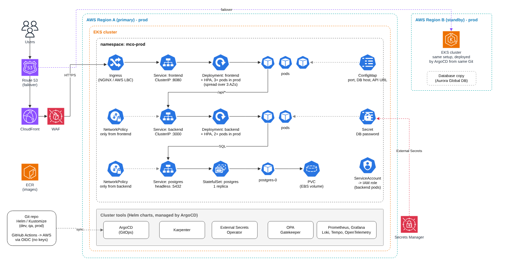

## How this setup would evolve for Kubernetes

The application has three tiers: frontend, backend and database. Each one returns a
"Hello World" message. On Kubernetes I would run each tier as its own workload.

### Environments and tools

- I would have three environments: dev, qa and prod. dev and qa get one EKS cluster each.
  prod gets two clusters in two different regions.
- Terraform creates the infrastructure (VPC, EKS, IAM, ECR).
- Helm or Kustomize manages the Kubernetes objects, with one values file or overlay per
  environment.
- ArgoCD deploys the application using GitOps. Git is the source of truth, and nobody
  changes the cluster by hand.
- GitHub Actions logs in to AWS using OIDC, so no AWS keys are stored in GitHub.

### Replicas

- **Frontend:** Deployment. 1 replica in dev and qa, at least 3 in prod with HPA.
- **Backend:** Deployment. 1 replica in dev and qa, at least 2 in prod with HPA.
- **Database:** StatefulSet with 1 replica.
- In prod, Karpenter (or Cluster Autoscaler) adds nodes when the HPA needs more pods.
- In prod, pods are spread across 3 availability zones, so the app keeps running if one
  zone goes down.

### Services

- The frontend has a ClusterIP Service and is exposed to users through an Ingress
  (NGINX ingress controller or AWS Load Balancer Controller).
- The backend has a ClusterIP Service only. It is not exposed to the internet, and a
  NetworkPolicy allows traffic only from the frontend.
- The database has a headless Service and accepts traffic only from the backend.
- The nginx `/api/` proxy now points to the backend Service name instead of `127.0.0.1`.
- CloudFront sits in front of the load balancer for HTTPS and caching, with AWS WAF to block
  bad traffic.

### PVCs

- SQLite is built into Node.js and runs inside the backend process, so it cannot run as a
  separate pod. For Kubernetes I would replace it with PostgreSQL running as a StatefulSet.
  This needs a small code change in the backend.
- The StatefulSet gets its own PVC (EBS volume), so the data survives pod restarts.
- If the database needs high availability inside the cluster, I would use the
  CloudNativePG operator. For a bigger application in production, I would use Amazon RDS
  or Aurora instead.

### Secrets and configuration

- Normal configuration (port, database host, API URL) goes into ConfigMaps.
- Secrets like the database password are stored in AWS Secrets Manager and synced into
  Kubernetes Secrets with the External Secrets Operator. Nothing secret goes into Git or
  the image.
- If a pod needs to access an AWS service, I would link its ServiceAccount to an IAM role.

### Rolling updates

- Frontend and backend use the RollingUpdate strategy with `maxSurge: 1` and
  `maxUnavailable: 0`. A new pod gets traffic only after its readiness probe passes
  (`/healthz` for the backend), so there is no downtime.
- PodDisruptionBudgets keep enough pods running during node maintenance.
- To roll back, I revert the commit in Git and ArgoCD deploys the previous version.

### Monitoring and access

- Prometheus and Grafana for metrics, Loki for logs, and Tempo for traces. OpenTelemetry
  collects the data from the applications.
- Users get cluster access through EKS access entries linked to their IAM roles, and
  Kubernetes RBAC controls what they can do in each namespace.
- OPA Gatekeeper checks every new resource against our rules, for example no root
  containers and resource limits required.

### Disaster recovery

- The two prod clusters are in two regions. If the main region fails, Route 53 moves
  traffic to the second region.
- The data must also be in the second region. With Aurora, a Global Database keeps a copy
  there.
- RPO (how much data we can afford to lose) and RTO (how fast we must be back) decide how
  much of this setup we need.
